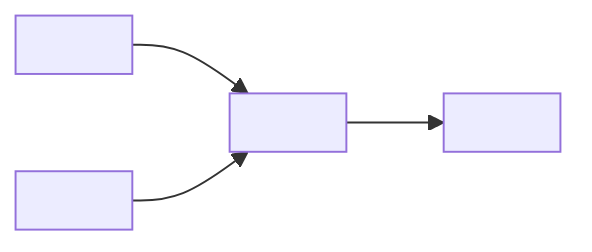

# 输出模板：DataWorks 工作流生成

`<>` 为占位符，产出时替换。

## 模板 1：工作流定义（JSON）

```json
{
  "name": "<etl_daily>",
  "description": "<每日订单 ETL>",
  "owner": "<责任人>",
  "schedule": {
    "type": "cron",
    "cron": "0 0 2 * * ?",
    "timezone": "Asia/Shanghai"
  },
  "nodes": [
    {
      "id": "<load_orders>",
      "type": "ODPS_SQL",
      "sql_file": "nodes/<load_orders>.sql",
      "params": { "dt": "${bizdate}" },
      "depends_on": [],
      "retry": { "max": 3, "interval_min": 10 }
    },
    {
      "id": "<transform_orders>",
      "type": "ODPS_SQL",
      "sql_file": "nodes/<transform_orders>.sql",
      "params": { "dt": "${bizdate}" },
      "depends_on": ["<load_orders>"],
      "retry": { "max": 3, "interval_min": 10 }
    }
  ]
}
```

## 模板 2：节点 SQL 模板

```sql
-- 节点：<node_id>
-- 依赖：${depends}
-- 参数：dt=${bizdate}

INSERT OVERWRITE TABLE <target_table> PARTITION (dt='${bizdate}')
SELECT
  <columns>
FROM <source_table>
WHERE dt = '${bizdate}';
```

## 模板 3：调度依赖图（Mermaid）



## 模板 4：参数说明

```markdown
| 参数 | 含义 | 默认 | 传参方式 |
| --- | --- | --- | --- |
| ${bizdate} | 业务日期（T-1） | - | 调度自动 |
| ${cyctime} | 定时时间 | - | 调度自动 |
| <custom> | <自定义> | <值> | <手动/运维> |
```

## 模板 5：部署 README

```markdown
# <workflow_name> 部署说明
1. 导入 JSON：<入口>
2. 上传节点 SQL：<路径>
3. 配置数据源：<依赖>
4. 试跑：手动触发一次，核对 <验收表>
5. 启用调度：<cron>
```
