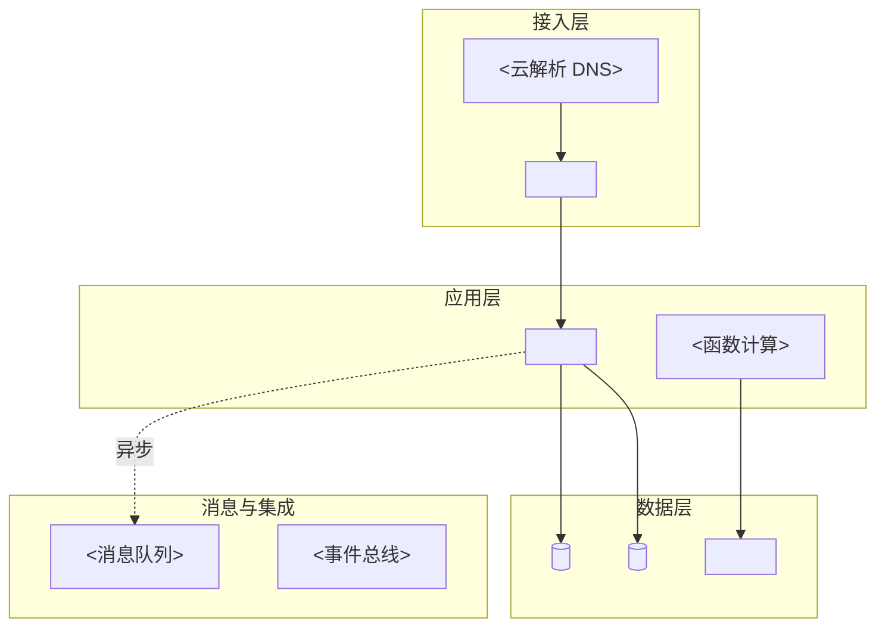

# 输出模板：跨云迁移方案生成

`<>` 为占位符，产出时替换。

## 模板 1：目标架构图（Mermaid）



## 模板 2：组件映射表

```markdown
| # | 源（AWS） | 用途 | 阿里云对应 | 规格选型 | 差异说明 |
| --- | --- | --- | --- | --- | --- |
| 1 | <EC2 c5.xlarge × 4> | <Web 服务> | <ECS> | <ecs.g7.xlarge × 4> | <无> |
| 2 | <Aurora MySQL> | <主库> | <PolarDB MySQL> | <8C32G 集群版> | <连接串格式不同> |
```

## 模板 3：差异与限制说明

```markdown
| 差异类别 | 源能力 | 阿里云现状 | 影响 | 处理方案 |
| --- | --- | --- | --- | --- |
| 产品缺失 | <Ground Station> | <无对应> | <功能不可用> | <业务层移除/第三方> |
| 能力差异 | <Lambda 15min 上限> | <FC 10min> | <长任务> | <改 SAE 常驻> |
| 计费差异 | <Savings Plans> | <预留实例券> | <成本模型> | <重测算> |
```

## 模板 4：实施路径

```markdown
| 阶段 | 周期 | 内容 | 前置依赖 | 里程碑 |
| --- | --- | --- | --- | --- |
| 阶段 1 | <第 1–2 周> | <网络与账号、监控接入> | 无 | <M1 网络打通> |
| 阶段 2 | <第 3–4 周> | <数据层迁移> | M1 | <M2 数据全量> |
| 阶段 3 | <第 5–6 周> | <应用切换与放量> | M2 | <M3 全量切流> |
```

## 模板 5：风险与前提

```markdown
| # | 风险 | 概率 | 影响 | 应对 | 责任方 |
| --- | --- | --- | --- | --- | --- |
| 1 | <源端带宽不足> | <中> | <延期 1 周> | <闪电立方> | <客户> |

### 前置条件（客户需提供）
- <源端资源清单与凭证>
- <迁移窗口与停机确认>
```
