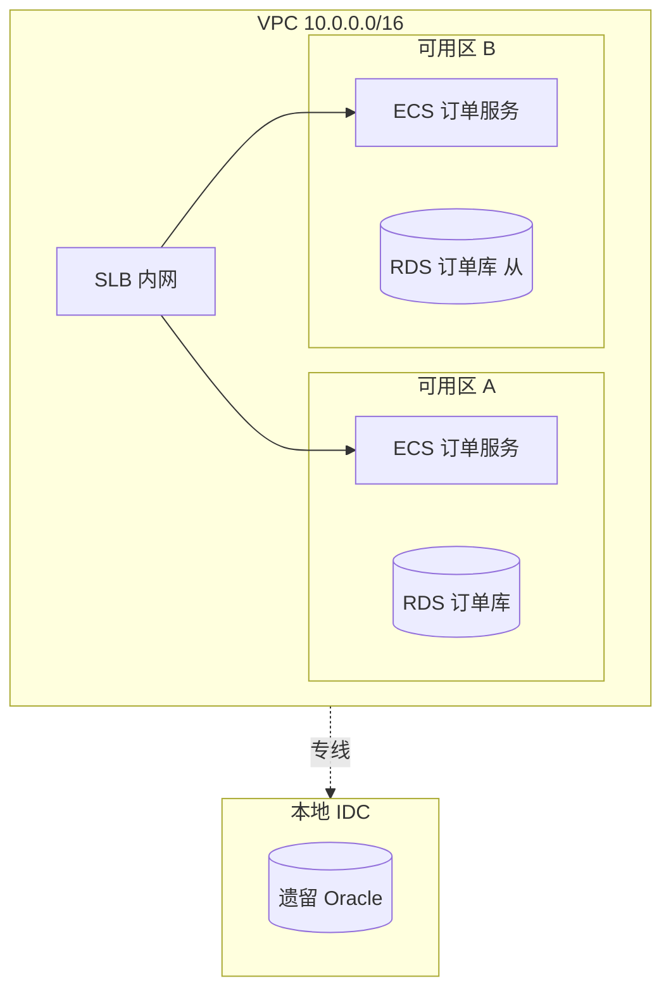

# 网络解耦关系分析

把"网络是怎么连的"这件事说清楚：VPC 边界、子网分布、跨区/跨域流量、入口与出口、安全控制点。面向阿里云迁云、混合云架构设计、安全边界梳理等场景。

## 输入

任意组合：

- 现有云账号资源清单（ECS、VPC、SLB、专线等）
- 网络架构图（Visio / drawio / PDF）
- 安全组规则导出、路由表、ACL
- DNS 解析记录、证书清单
- 应用入口域名与备案信息

## 工作流

### 第 1 步 资产清点

按四层建模：

| 层 | 抽取项 |
| --- | --- |
| 接入层 | 公网 IP、负载均衡（SLB / ALB）、API 网关、CDN、WAF |
| 网络层 | VPC、VSwitch、路由表、NAT 网关、VPN/专线、 peering |
| 安全层 | 安全组、网络 ACL、堡垒机、零信任网关 |
| 数据层 | 数据库内网域名、Redis 内网地址、Kafka 内网 endpoint |

### 第 2 步 拓扑绘制

产出 Mermaid `flowchart` 图，按可用区着色：

### 第 3 步 流量识别

标注四类关键流量：

- **跨可用区流量**：同步复制、读写分离、集群心跳
- **跨 VPC 流量**：服务调用、数据同步
- **跨地域流量**：灾备、同步、备份
- **南北向流量**：来自公网的入口与去向公网的回调

### 第 4 步 风险点识别

- **公网暴露**：不该直连公网的资源（数据库、Redis、k8s API）有公网 IP
- **安全组过宽**：规则 0.0.0.0/0 或过粗粒度
- **单点专线**：单一物理链路、缺冗余
- **DNS 跨域**：依赖跨账号 / 跨地域 DNS 解析的链路
- **证书集中**：所有证书在单一 K8s namespace，迁移期需重新分发

### 第 5 步 迁移映射

针对阿里云目标，给出每个资源的映射关系：

| 源资源 | 阿里云对应 | 说明 |
| --- | --- | --- |
| AWS VPC | VPC | 私网 CIDR 需提前规划避免冲突 |
| AWS Transit Gateway | CEN 转发路由器 | 跨账号 / 跨地域 |
| AWS Direct Connect | 高速通道 / 智能接入网关 | 按带宽与 SLA 选型 |
| AWS Shield Advanced | 阿里云 DDoS 高防 / WAF | 大流量场景按需 |
| AWS Route 53 | 云解析 DNS | 保留记录类型差异 |

## 输出交付物

| 文件 | 格式 |
| --- | --- |
| 拓扑图 | Mermaid / Graphviz，可导出 PNG |
| 资源映射表 | Excel / Markdown |
| 风险点清单 | Markdown |
| 阿里云资源规划 | Markdown（按账号 / 地域 / VPC 组织） |

## 边界

- **不做**：真实流量抓包分析（需要 VPC 流日志 / tcpdump，超出静态分析）。
- **依赖**：现有云账号资源清单的获取方式由客户提供。
- **跨账号场景**：需要客户提供账号 ID、RAM 角色、信任关系。

---

## 输出模板

所有交付物模板见 `references/templates.md`。产出文档时按模板填充，不自创结构；模板未覆盖的字段按项目实际补充并在交付物中注明。

## 可调用能力

执行过程中按需调用以下已安装能力，不要凭记忆硬写命令：

| 能力 | 用途 | 调用说明 |
| --- | --- | --- |
| aliyun-cli skill | 拉取真实网络资源建模 | `aliyun vpc DescribeVpcs` / `DescribeVSwitches` / `DescribeRouteTables`、`aliyun ecs DescribeSecurityGroups`、`aliyun slb DescribeLoadBalancers`；跨域链路查 `aliyun cen ...`；参数名先过 `--help` 核对 |
| alibabacloud-cli-guidance | 阿里云 CLI 使用规范 | 已安装 |
| find-skills skill | 检索未覆盖的网络类产品能力 | 本地市场优先 |
