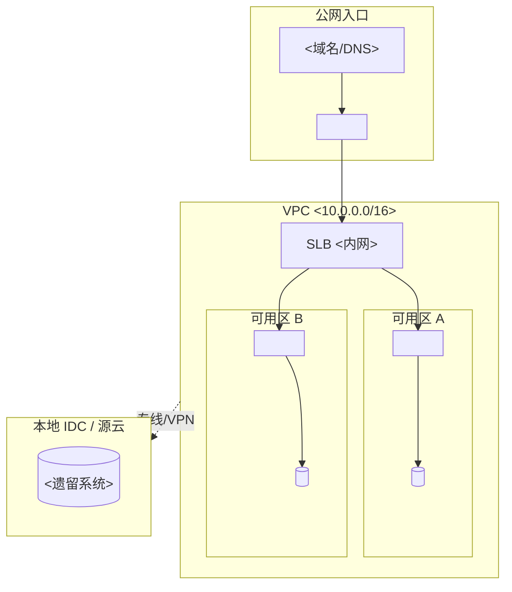

# 输出模板：网络解耦关系分析

`<>` 为占位符，产出时替换。

## 模板 1：网络拓扑图（Mermaid）



## 模板 2：资源映射表

```markdown
| # | 源资源 | 类型 | 源标识 | 阿里云对应 | 规格建议 | 迁移注意 |
| --- | --- | --- | --- | --- | --- | --- |
| 1 | <AWS VPC> | 网络 | vpc-xxx | VPC | <同 CIDR 或新规划> | <CIDR 冲突检查> |
| 2 | <DX 专线> | 链路 | dx-xxx | 高速通道 | <带宽> | <冗余双路> |
```

## 模板 3：流量识别清单

```markdown
| 流量类型 | 源 | 目标 | 协议/端口 | 频率 | 迁移影响 |
| --- | --- | --- | --- | --- | --- |
| 跨可用区 | <AZ-A> | <AZ-B> | <TCP 3306> | <持续> | <同步延迟> |
| 跨 VPC | <VPC-A> | <VPC-B> | <HTTP 8080> | <峰值 500 QPS> | <CEN 接入> |
```

## 模板 4：风险点清单

```markdown
| # | 风险类型 | 位置 | 描述 | 严重性 | 整改建议 |
| --- | --- | --- | --- | --- | --- |
| 1 | 公网暴露 | <RDS 实例> | <数据库直接挂 EIP> | 🔴 | <收内网+白名单> |
| 2 | 安全组过宽 | <SG-xxx> | <0.0.0.0/0 放行 22> | 🔴 | <限源 IP> |
| 3 | 单点专线 | <DX-1> | <无备份链路> | ⚠️ | <加 VPN 兜底> |
```

## 模板 5：阿里云资源规划

```markdown
### 地域与账号
- 地域：<cn-hangzhou>，可用区：<A/B>
- 账号结构：<主账号/RAM 子账号>

### VPC 规划
| VPC | CIDR | 用途 | 包含交换机 |
| --- | --- | --- | --- |
| <vpc-prod> | <10.0.0.0/16> | <生产> | <vsw-a 10.0.1.0/24, vsw-b 10.0.2.0/24> |
```
