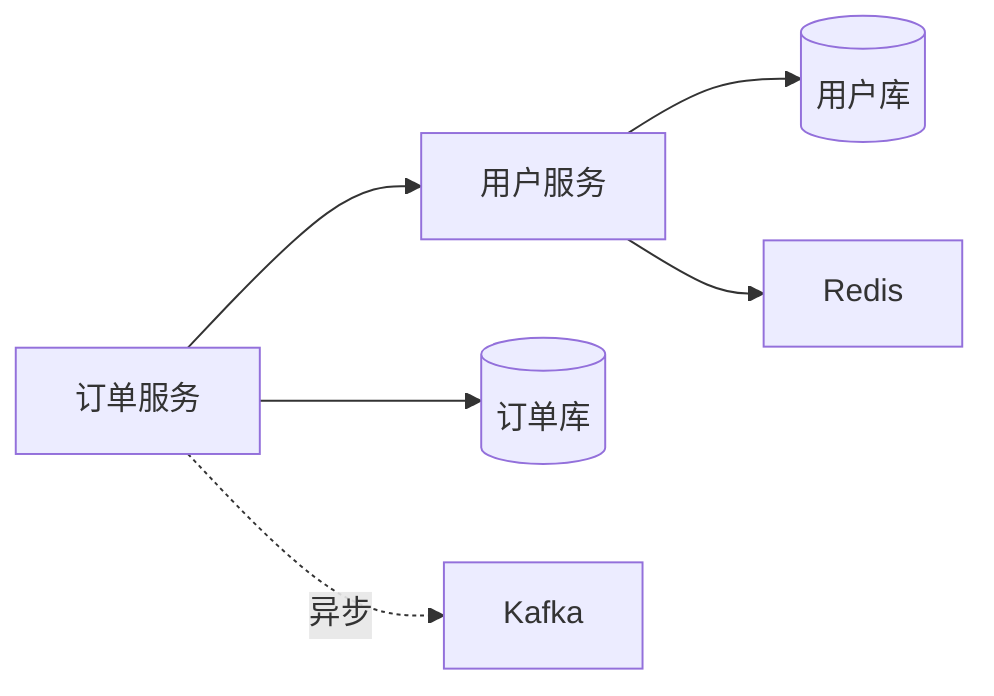

# 软件解耦关系分析

把"模块间是怎么连在一起的"这件事说清楚：依赖方向、强弱、循环、单点、迁移影响面。面向阿里云迁云等场景，给出可在方案文档里直接引用的依赖图与解耦建议。

## 输入

任意组合：

- 源代码目录（指定语言或扩展名）
- 架构图 / 设计文档（Word / PDF / Markdown / drawio）
- API 文档 / OpenAPI 规范文件
- 系统清单（部署清单、CMDB 导出）
- 既有依赖图（PlantUML / Mermaid / Graphviz）

## 工作流

### 第 1 步 清点资产

逐源读取，按四类建模：

| 类型 | 抽取方式 |
| --- | --- |
| 代码依赖 | import / require / include / package |
| 服务依赖 | HTTP / RPC / 消息队列 / DB 连接字符串 |
| 数据依赖 | 共享表、共享文件、共享缓存 key 前缀 |
| 配置依赖 | 环境变量、配置中心 key 路径、Secret 引用 |

### 第 2 步 构建依赖图

产出 Mermaid / Graphviz 两种格式之一，默认 Mermaid（便于嵌入飞书 / Markdown）：



按层着色：接入层 / 业务层 / 数据层 / 基础设施。

### 第 3 步 识别问题

自动标记：

- **循环依赖**：A→B→A 类，标注参与节点与影响面
- **强耦合**：调用频率 > 阈值 / 同步阻塞 / 共享数据库表
- **单点故障**：唯一提供者、无降级路径
- **跨边界调用**：本应通过 API 网关却直连的调用
- **未文档化依赖**：代码里有但文档没记录的依赖

### 第 4 步 迁移影响分析

针对迁云场景，每个模块标注：

| 字段 | 取值 |
| --- | --- |
| 迁移目标 | 阿里云可直接迁移 / 需重构 / 需替换 |
| 影响面 | 依赖该模块的下游数 |
| 风险等级 | 高 / 中 / 低 |
| 改造工作量 | 人天区间 |
| 替代方案 | 阿里云对应产品或替代实现 |

### 第 5 步 输出报告

```
- 依赖图（mermaid + 可选 PNG 渲染）
- 模块清单（ID、责任人、迁移目标、风险）
- 关键问题清单（循环、强耦合、单点）
- 迁移影响分析（按优先级排序）
- 解耦建议（短期 / 中期 / 长期）
```

## 输出交付物

| 文件 | 格式 | 说明 |
| --- | --- | --- |
| 依赖图 | Mermaid / Graphviz | 可嵌入 Markdown 或导出 PNG/SVG |
| 模块清单 | Excel / Markdown | 含迁移目标与风险 |
| 关键问题清单 | Markdown | 标注问题类型与位置 |
| 迁移影响分析 | Markdown | 按优先级排序 |
| 解耦建议 | Markdown | 分短期 / 中期 / 长期 |

## 边界

- **不做**：动态运行时调用追踪（需要 APM 数据，不在静态分析范围内）。
- **依赖外部图渲染**：mermaid-cli、Graphviz 等工具按需调用，无则在 Markdown 里保留源码。
- **代码量大时分模块扫描**：不要一次加载百万行源码。


---

## 输出模板

所有交付物模板见 `references/templates.md`。产出文档时按模板填充，不自创结构；模板未覆盖的字段按项目实际补充并在交付物中注明。

## 可调用能力

执行过程中按需调用以下已安装能力，不要凭记忆硬写命令：

| 能力 | 用途 | 调用说明 |
| --- | --- | --- |
| aliyun-cli skill | 拉取 ECS / SLB 资产清单辅助建模 | `aliyun ecs DescribeInstances`、`aliyun slb DescribeLoadBalancers`；参数名先过 `aliyun <product> --help` 核对 |
| alibabacloud-ecs-diagnose | ECS 层面健康与依赖诊断 | 已安装，按需加载 |
| find-skills skill | 本 skill 未覆盖的云产品能力检索 | 先查本地市场 `~/.workbuddy/skills-marketplace/skills`，再走 SkillHub 语义搜索 |
