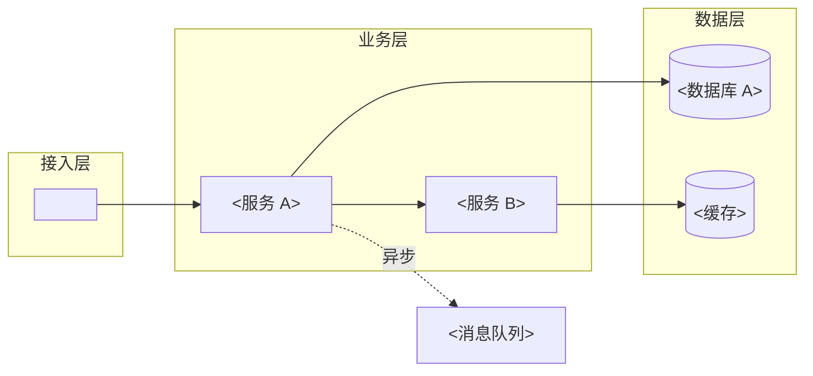

# 输出模板：软件解耦关系分析

`<>` 为占位符，产出时替换。模板未覆盖的字段按项目实际补充并注明。

## 模板 1：依赖图（Mermaid）



着色约定：接入层 / 业务层 / 数据层 / 基础设施 分别用统一色系；虚线表示异步调用。

## 模板 2：模块清单

```markdown
| 模块 ID | 模块名 | 层级 | 迁移目标 | 依赖数（下游） | 风险等级 | 改造工作量（人天） | 责任人 |
| --- | --- | --- | --- | --- | --- | --- | --- |
| M-001 | <订单服务> | 业务层 | <阿里云 ECS / SAE> | <6> | <高> | <15–20> | <张三> |
```

## 模板 3：关键问题清单

```markdown
| # | 问题类型 | 位置 | 参与节点 | 描述 | 影响面 | 处置建议 |
| --- | --- | --- | --- | --- | --- | --- |
| 1 | 循环依赖 | <order.py:120> | <A, B> | <A 调 B，B 回调 A> | <切换时死锁> | <引入事件解耦> |
| 2 | 强耦合 | <user.py:88> | <B→C> | <同步阻塞调用，RT 200ms> | <切换窗口> | <改异步> |
```

## 模板 4：迁移影响分析

```markdown
### <模块名>
- 迁移目标：<阿里云产品>
- 影响面：<N 个下游模块>
- 风险等级：<高/中/低>（理由）
- 改造工作量：<X–Y 人天>
- 替代方案：<产品或实现>
```

## 模板 5：解耦建议

```markdown
| 时间窗 | 建议 | 预期收益 | 成本 |
| --- | --- | --- | --- |
| 短期（<1 周） | <加缓存/降级> | <RT 降 30%> | <2 人天> |
| 中期（2–4 周） | <拆分 X> | <独立部署> | <10 人天> |
| 长期（>1 月） | <事件化改造> | <弹性伸缩> | <30+ 人天> |
```
